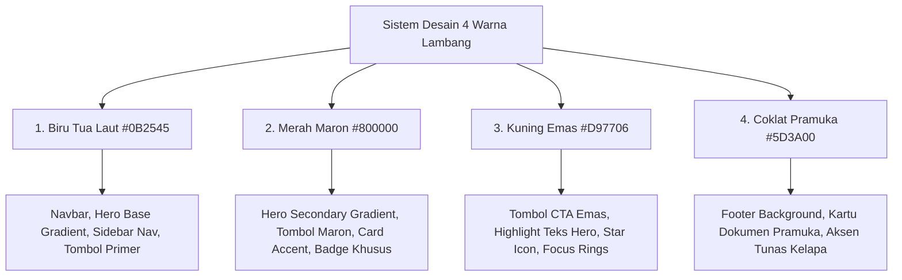

# 🌲 Master Design System & Layout Guideline — Racana UNSA

Dokumen arsitektur desain, antarmuka pengguna (UI/UX), dan panduan tata letak (*layout*) resmi untuk ekosistem aplikasi web **Racana Universitas Samawa (UNSA)** — mencakup **Portal Publik Kegiatan**, **Portal Dashboard Kontingen Sekolah**, **Panel Administrator Panitia**, serta **Engine Cetak Dokumen Resmi Kepramukaan**.

Sistem desain ini secara konsisten mengusung **4 Palet Warna Lambang Resmi**:
1. **🌊 Biru Tua Laut (*Deep Ocean Navy*)**: Representasi identitas akademik almamater Universitas Samawa (UNSA) dan kelautan Samawa.
2. **🛡️ Merah Maron (*Deep Maroon/Crimson*)**: Representasi jiwa ksatria, keberanian, dan keteguhan tekad kepanduan.
3. **⭐ Kuning Emas (*Scout Gold/Royal Amber*)**: Representasi kejayaan, kehormatan, prestasi luhur, dan bintang pandu.
4. **🏕️ Coklat Pramuka (*Scout Earth Brown*)**: Representasi resmi warna seragam Gerakan Pramuka Indonesia dan kesederhanaan bakti alam.

---

## 🎨 1. Palet Warna & Token Desain (Design Tokens)

### A. Palet 4 Warna Utama Lambang (*Core Brand Palette*)

| Token Warna | Nilai HEX | Nilai RGB / HSL | Penggunaan Utama |
| :--- | :--- | :--- | :--- |
| **`--scout-navy-primary`** | `#0b2545` | `rgb(11, 37, 69)` / `hsl(213, 72%, 16%)` | Warna brand utama, header navbar, tombol primer, judul section |
| **`--scout-navy-dark`** | `#07172b` | `rgb(7, 23, 43)` / `hsl(213, 72%, 10%)` | Sidebar admin/dashboard, deep hero background, header ID card |
| **`--scout-navy-light`** | `#133e87` | `rgb(19, 62, 135)` / `hsl(218, 75%, 30%)` | Active nav link, gradient accent, border fokus interaktif |
| **`--scout-maroon-main`** | `#800000` | `rgb(128, 0, 0)` / `hsl(0, 100%, 25%)` | Merah Maron ksatria, tombol maron, hero secondary gradient |
| **`--scout-maroon-dark`** | `#550000` | `rgb(85, 0, 0)` / `hsl(0, 100%, 17%)` | Border tegas maron, header footer accent, hover state maron |
| **`--scout-maroon-light`** | `#991b1b` | `rgb(153, 27, 27)` / `hsl(0, 70%, 35%)` | Highlight badge maron, border alert bahaya / kunci pendaftaran |
| **`--scout-gold-main`** | `#d97706` | `rgb(217, 119, 6)` / `hsl(38, 95%, 44%)` | Tombol CTA utama (*Gold*), bintang prestasi, border emas kartu |
| **`--scout-gold-bright`** | `#ffd700` | `rgb(255, 215, 0)` / `hsl(51, 100%, 50%)` | Highlight teks hero, ikon khusus, badge unggulan |
| **`--scout-gold-light`** | `#fef3c7` | `rgb(254, 243, 199)` / `hsl(48, 96%, 89%)` | Background badge emas, box alert info pengumuman |
| **`--scout-brown-main`** | `#5d3a00` | `rgb(93, 58, 0)` / `hsl(37, 100%, 18%)` | Coklat Pramuka resmi, aksen kehormatan pandu, kartu kepanduan |
| **`--scout-brown-dark`** | `#3e2600` | `rgb(62, 38, 0)` / `hsl(37, 100%, 12%)` | Footer deep background, watermark ornamen Tunas Kelapa |
| **`--scout-brown-light`** | `#78350f` | `rgb(120, 53, 15)` / `hsl(22, 78%, 26%)` | Tombol coklat, border kartu pramuka |

### B. Palet Status Fungsional (*Semantic Colors*)

| Status | HEX | Background Soft | Fungsi / Indikator |
| :--- | :--- | :--- | :--- |
| **Success / Terverifikasi** | `#16a34a` | `#dcfce7` | Berkas Diterima, Pembayaran Lunas, Akses Terbuka |
| **Warning / Menunggu** | `#f59e0b` | `#fef3c7` | Menunggu Verifikasi Berkas, Menunggu Konfirmasi Bayar, Data Draf |
| **Danger / Terkunci** | `#dc2626` | `#fee2e2` | Pendaftaran Terkunci (Final Resmi), Pembayaran Ditolak, Hapus Data |
| **Info / Panduan** | `#0284c7` | `#e0f2fe` | Pengumuman, Juknis Lomba, Nomor Rekening Transfer |

### C. Palet Netral & Permukaan (*Surfaces & Grayscale*)

| Token | HEX | Deskripsi & Penggunaan |
| :--- | :--- | :--- |
| `--bg-canvas` | `#f8fafc` | Background utama aplikasi (Slate 50) |
| `--surface-card` | `#ffffff` | Background kartu, container konten, form modal |
| `--surface-subtle` | `#f1f5f9` | Background tabel header, input disable, card header |
| `--border-subtle` | `#e2e8f0` | Border pemisah kartu, garis tabel, pembatas form |
| `--text-dark` | `#0f172a` | Teks judul utama, angka metrik, label form tebal |
| `--text-body` | `#334155` | Teks paragraf, isi konten, data tabel |
| `--text-muted` | `#64748b` | Keterangan tambahan, metadata tanggal, placeholder |

---

## ✍️ 2. Sistem Tipografi & Font Scale

### A. Font Families
1. **Headings & Brand**: `'Plus Jakarta Sans', 'Poppins', sans-serif` (Tegas, kokoh, geometris, modern).
2. **Body & Content**: `'Plus Jakarta Sans', 'Roboto', sans-serif` (Sangat nyaman dibaca pada teks juknis dan formulir).
3. **Codes & Token**: `'JetBrains Mono', 'SF Mono', Consolas, monospace` (Kode bayar, token QR, NISN, NTA, Gudep).

### B. Skala Hirarki Tipografi

| Level | Ukuran (Desktop) | Ukuran (Mobile) | Weight | Line Height | Penggunaan |
| :--- | :--- | :--- | :--- | :--- | :--- |
| **Display Hero** | `42px - 48px` | `30px - 34px` | 800 (Extra Bold) | 1.15 | Judul Utama Hero Portal Publik |
| **Heading 1 (H1)** | `32px` | `26px` | 800 (Bold) | 1.25 | Judul Halaman Utama / Modul |
| **Heading 2 (H2)** | `24px` | `20px` | 700 (Bold) | 1.30 | Sub-judul Section, Judul Kartu Besar |
| **Heading 3 (H3)** | `18px - 20px` | `16px - 18px` | 600 (Semi Bold) | 1.35 | Judul Kartu Lomba, Section Form |
| **Heading 4 (H4)** | `15px - 16px` | `14px - 15px` | 600 (Semi Bold) | 1.40 | Header Kolom Tabel, Label Tab |
| **Body Large** | `16px` | `15px` | 400 / 500 | 1.60 | Lead paragraph hero, ringkasan juknis |
| **Body Regular** | `14px` | `13.5px` | 400 (Regular) | 1.55 | Teks standar form, data tabel, artikel |
| **Small / Caption** | `12px` | `11.5px` | 500 / 600 | 1.40 | Badge status, timestamp, petunjuk input |

---

## 🖼️ 3. Arsitektur Layout Berbasis 4 Warna Lambang



---

### A. Portal Publik (Landing Page, Profil & Cabang Lomba)
1. **Header & Navigation Bar**:
   - Tipe: *Sticky with blur backdrop* (`backdrop-filter: blur(14px)`).
   - Background: Putih transparan `rgba(255, 255, 255, 0.96)` dengan garis bawah biru tua laut `rgba(11, 37, 69, 0.15)`.
   - Brand Icon: Gradasi Biru Tua Laut ke Merah Maron dengan ikon tenda kepanduan emas `#ffd700`.
   - Tombol CTA Header: Tombol Emas (`btn-scout-gold`) untuk *Daftar Akun Sekolah* & Tombol Biru Laut (`btn-outline-navy`) untuk *Login*.
2. **Hero Section**:
   - Background: Gradasi elegan perpaduan Biru Tua Laut dan Merah Maron malam:  
     `linear-gradient(135deg, #07172b 0%, #0b2545 45%, #800000 85%, #3e2600 100%)`.
   - Ornamen: Radial glow emas `#d97706`, dot matrix subtle, dan badge hitung mundur status pendaftaran.
   - Dual CTA Hero: Tombol Emas (`btn-scout-gold`) + Tombol Outline Maron/Biru.
3. **Showcase Lomba Aktif (Grid 3-4 Kolom)**:
   - Kartu interaktif bergaris tepi biru tua laut dengan aksen badge kategori emas & maron.
4. **Footer Publik Multi-Tier**:
   - Background: Perpaduan Coklat Pramuka Gelap `#3e2600` dan Biru Tua Laut `#07172b`.
   - Ornamen: Watermark Tunas Kelapa transparan, kontak sekretariat, dan tautan navigasi.

---

### B. Portal Dashboard Kontingen Sekolah
1. **Sidebar Navigasi (Width: 275px)**:
   - Background: Gradasi Biru Tua Laut malam `linear-gradient(180deg, #07172b 0%, #0b2545 100%)`.
   - Active Menu Item: Gradasi Biru Tua Terang ke Biru Laut `linear-gradient(90deg, #133e87 0%, #0b2545 100%)` berhiaskan aksen garis emas.
2. **Top Header & Lock Status Alert**:
   - Menampilkan identitas pangkalan sekolah, lokasi, serta **Badge Kunci Akses (TERBUKA / TERKUNCI)**.
3. **Multi-Batch Registration Form (24 Kuota)**:
   - Sistem **4 Tab Navigasi**: Barisan Putra (10), Barisan Putri (10), Bindamping Putra (2), Bindamping Putri (2).
   - Floating Action Bar di bagian bawah:
     - Draf: Tombol Kuning Emas (`btn-scout-gold`).
     - Simpan & Finalisasi Resmi: Tombol Biru Laut (`btn-scout-primary`) atau Merah Maron (`btn-scout-maroon`).
     - Terkunci: Alert merah penguncian aktif + Tombol Cetak ID Card & Formulir A.01.

---

### C. Panel Administrator Panitia
1. **Statistik Metrik (KPI Cards 4 Kolom)**:
   - Total Kontingen Sekolah (Border Biru Tua Laut).
   - Total Peserta Aktif (Border Kuning Emas).
   - Total Pembayaran Lunas (Border Hijau Sukses).
   - Verifikasi & Kunci Pendaftaran (Border Merah Maron).
2. **Tabel Kontingen Terpadu & Kendali 1-Klik**:
   - Kolom Akses Kunci dengan badge 1-klik buka/kunci pendaftaran.

---

### D. Engine Cetak & Dokumen Resmi (Format A4 Standar)
1. **Formulir Rekapitulasi Kontingen (Formulir A.01)**:
   - Kop Surat Resmi: Logo Kwartir / WOSM, Logo Racana UNSA, Logo Universitas Samawa.
   - Tabel Data Anggota berbingkai Biru Laut / Coklat Pramuka presisi.
2. **ID Card / Co-Card Peserta (Format B2 / CR80)**:
   - Header Biru Tua Laut & Emas.
   - Foto 3x4 berbingkai Biru Laut / Emas.
   - QR Code Token verifikasi keaslian panitia.

---

## 🧩 4. Spesifikasi Komponen UI (CSS Classes)

```css
/* 1. Tombol Biru Tua Laut (Primary) */
.btn-scout-primary, .btn-scout-navy {
    background: linear-gradient(135deg, #0b2545 0%, #07172b 100%);
    color: #ffffff;
    font-weight: 600;
    border: none;
    border-radius: 8px;
    padding: 10px 24px;
    box-shadow: 0 4px 14px rgba(11, 37, 69, 0.25);
    transition: all 0.25s ease;
}
.btn-scout-primary:hover, .btn-scout-navy:hover {
    background: linear-gradient(135deg, #133e87 0%, #0b2545 100%);
    color: #ffffff;
    transform: translateY(-2px);
    box-shadow: 0 6px 20px rgba(11, 37, 69, 0.35);
}

/* 2. Tombol Merah Maron (Maroon) */
.btn-scout-maroon {
    background: linear-gradient(135deg, #800000 0%, #550000 100%);
    color: #ffffff;
    font-weight: 600;
    border: none;
    border-radius: 8px;
    padding: 10px 24px;
    box-shadow: 0 4px 14px rgba(128, 0, 0, 0.25);
    transition: all 0.25s ease;
}
.btn-scout-maroon:hover {
    background: linear-gradient(135deg, #991b1b 0%, #800000 100%);
    color: #ffffff;
    transform: translateY(-2px);
    box-shadow: 0 6px 20px rgba(128, 0, 0, 0.35);
}

/* 3. Tombol Kuning Emas (CTA Gold) */
.btn-scout-gold {
    background: linear-gradient(135deg, #d97706 0%, #b45309 100%);
    color: #ffffff;
    font-weight: 700;
    border: none;
    border-radius: 8px;
    padding: 10px 24px;
    box-shadow: 0 4px 14px rgba(217, 119, 6, 0.3);
    transition: all 0.25s ease;
}
.btn-scout-gold:hover {
    background: linear-gradient(135deg, #f59e0b 0%, #d97706 100%);
    color: #ffffff;
    transform: translateY(-2px);
    box-shadow: 0 6px 20px rgba(217, 119, 6, 0.4);
}

/* 4. Tombol Coklat Pramuka (Scout Brown) */
.btn-scout-brown {
    background: linear-gradient(135deg, #5d3a00 0%, #3e2600 100%);
    color: #ffffff;
    font-weight: 600;
    border: none;
    border-radius: 8px;
    padding: 10px 24px;
    box-shadow: 0 4px 14px rgba(93, 58, 0, 0.25);
    transition: all 0.25s ease;
}
.btn-scout-brown:hover {
    background: linear-gradient(135deg, #78350f 0%, #5d3a00 100%);
    color: #ffffff;
    transform: translateY(-2px);
}
```

---

## 📱 5. Standar Responsivitas & Aksesibilitas (WCAG 2.1 AAA)

1. **Rasio Kontras Warna**:
   - Teks `#ffffff` pada background `--scout-navy-primary` (`#0b2545`) = **Rasio 14.8:1 (Lolos AAA)**.
   - Teks `#ffffff` pada background `--scout-maroon-main` (`#800000`) = **Rasio 9.8:1 (Lolos AAA)**.
   - Teks `#ffffff` pada background `--scout-brown-main` (`#5d3a00`) = **Rasio 9.8:1 (Lolos AAA)**.
   - Teks `#0f172a` pada background `--bg-canvas` (`#f8fafc`) = **Rasio 15.2:1 (Lolos AAA)**.
2. **Navigasi & Fokus**: Outline fokus keyboard menggunakan warna emas `#d97706` dengan ketebalan 2px.

---

## 📋 6. Checklist Verifikasi 4 Warna Lambang

- [x] **Biru Tua Laut** diterapkan sebagai warna primer brand, navbar, tombol utama, dan sidebar admin.
- [x] **Merah Maron** diterapkan pada aksen hero gradient, tombol maron ksatria, dan card highlight.
- [x] **Kuning Emas** diterapkan pada tombol CTA utama, bintang prestasi, highlight judul hero, dan glow ornamen.
- [x] **Coklat Pramuka** diterapkan pada latar belakang footer, aksen kepramukaan resmi, dan dokumen cetak.
- [x] Seluruh komponen UI, badge, kartu, formulir multi-batch, dan dokumen cetak ID Card selaras tanpa konflik warna.
